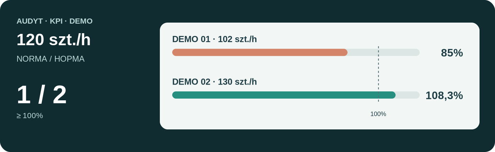
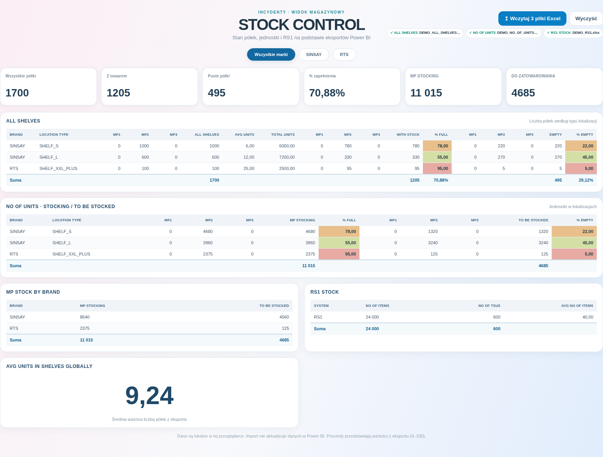
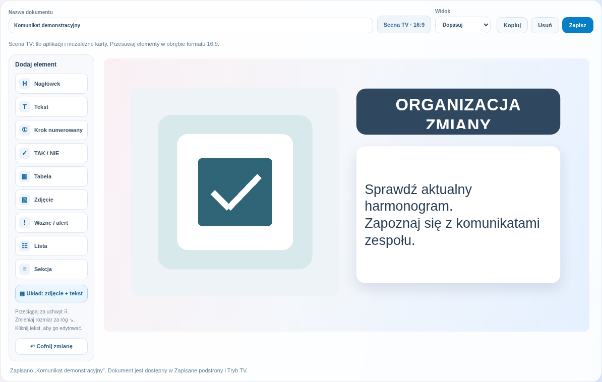
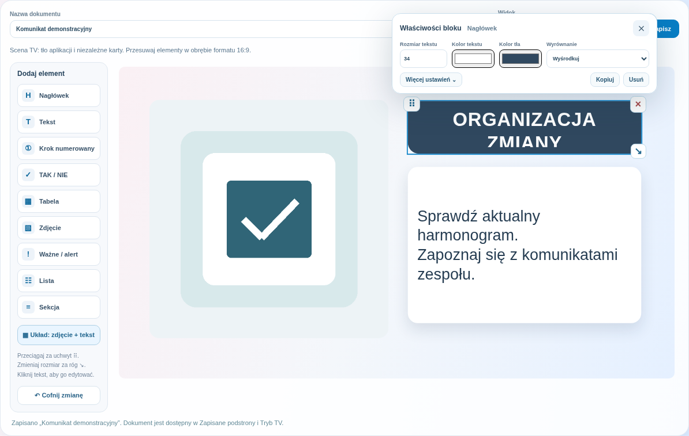
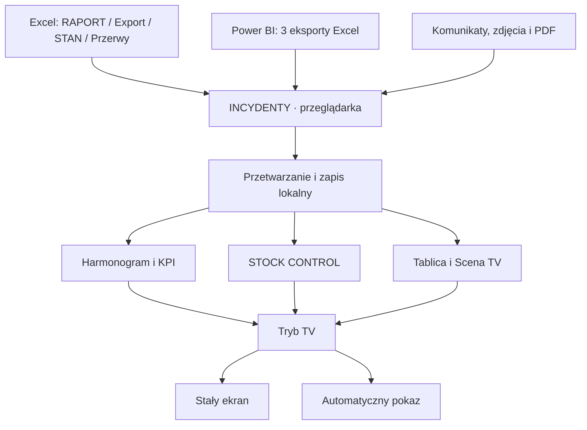

  
  <h1>INCYDENTY</h1>
  
<strong>Panel informacyjny działu</strong>

  
Harmonogram · KPI · Kontrola magazynu · Komunikacja na TV

  
  
  

  
<a href="README.md">Polski</a> · <a href="README_RU.md">Русский</a> · <a href="CHANGELOG.md">Historia / История</a>

  

## O projekcie

INCYDENTY to panel informacyjny PWA przeznaczony dla stanowiska kierującego zmianą i dużych ekranów na hali. Zamiast osobnych arkuszy i prezentacji pozwala przygotować dane, ogłoszenia i kolejność pokazu w jednym miejscu. Interfejs jest po polsku; niniejsza dokumentacja dostępna jest także [po rosyjsku](README_RU.md).

| Moduł | Co daje zespołowi |
|---|---|
| **Harmonogram pracy** | Przydziały, nieobecności, godziny przerw i widżety |
| **Wyniki i normy** | Wyniki procesów i indywidualne karty pracowników |
| **STOCK CONTROL** | Stan półek, zatowarowanie i dane RS1 z eksportów Power BI |
| **Tablica informacyjna** | Komunikaty, zdjęcia, PDF oraz własne sceny 16:9 |

[Uruchomienie](#uruchomienie-i-instalacja) · [Moduły](#moduły) · [Formaty danych](#formaty-danych-i-wzory-excel) · [Tryb TV](#tryb-tv) · [Dokumentacja](#dokumentacja-i-wersje)

## Uruchomienie i instalacja

**[Otwórz INCYDENTY](https://horkiroman4408-cyber.github.io/Panel-informacyjny/)**. Nie trzeba pobierać instalatora. Przy pierwszym uruchomieniu wczytaj własne dane lub pliki przykładowe z sekcji poniżej.

| Microsoft Edge | Google Chrome |
|---|---|
| Otwórz stronę → `…` → **Aplikacje** → **Zainstaluj tę witrynę jako aplikację**. | Otwórz stronę → ikona instalacji w pasku adresu lub menu `⋮` → opcja instalacji strony jako aplikacji. |

Jeśli pojawi się przycisk **Zainstaluj** w aplikacji, można użyć również jego. Nazwy poleceń zależą od wersji przeglądarki. Praca offline jest dostępna po poprawnym zapisaniu zasobów PWA; sprawdź **Informacje → Aplikacja**. Aktualizację najlepiej uruchamiać po zakończeniu pokazu.

## Moduły

### 01 · Harmonogram pracy

Wczytaj grafik `STAN` i osobny plik przerw. Wybierz zmianę oraz czas pracy 8H, 10H lub 12H. Widżety można rozmieszczać, a ikoną oka określać widoczność osób i zespołów na TV. Panel wyróżnia trwającą przerwę lub najbliższą, jeśli zaczyna się w ciągu 30 minut.

### 02 · Wyniki i normy

**Wyniki procesów**: raport Excel `RAPORT`, norma procesu, liczba osób osiągających normę, wydajność w szt./h i procent realizacji. Ustaw okres raportu, filtruj, sortuj i wybieraj `Przegląd` lub `Jeden proces`. Nowy raport zastępuje poprzedni.

**Karty pracowników**: import do 25 plików jednocześnie, identyfikacja według `Login TH` i okresu, KPI ważone czasem, godziny oraz wszystkie procesy danej osoby. Ponowny import tego samego loginu i identycznego okresu aktualizuje kartę; inny okres tworzy osobny zapis. Karty i raport procesów są przechowywane oddzielnie.

#### Jak czytać KPI

- Realizacja normy = wynik w szt./h ÷ norma × 100%.
- KPI za okres = suma (KPI procesu × czas procesu) ÷ suma czasów.
- Procesy w normie = liczba procesów z KPI co najmniej 100% względem wszystkich procesów pracownika.

*Dane demonstracyjne z przykładowego raportu: 85% oraz 108,3%, czyli jedna z dwóch osób osiąga normę.*

### 03 · STOCK CONTROL

Wczytaj trzy eksporty `.xlsx` z Power BI: **ALL SHELVES**, **NO OF UNITS** i **RS1 STOCK**. Aplikacja identyfikuje pliki według kolumn w arkuszu `Export`, nie według nazwy pliku. Pokazuje wszystkie półki, półki z towarem, puste półki, procent zapełnienia, MP STOCKING i **DO ZATOWAROWANIA**. Dodatkowo prezentuje tabele wg typu lokalizacji, marki, RS1 i średnią ważoną liczby jednostek na półkę.

Wysokie zapełnienie jest wyróżnione czerwienią, niższe zielenią; kolor `% EMPTY` odpowiada uzupełniającemu zapełnieniu. Można wybrać wszystkie dostępne marki lub filtrować widok. W TV dostępne są ekrany zbiorczy, SINSAY i RTS; w RTS nie ma tabeli RS1. Dane aktualizuje się przez ponowny import, **nie przez połączenie na żywo z Power BI**.

*Zrzut modułu z izolowanego uruchomienia kodu; liczby i nazwy plików są demonstracyjne.*

### 04 · Tablica informacyjna

Trzy sposoby przygotowania treści w `Zapisane podstrony`:

| Typ | Zastosowanie |
|---|---|
| **Nowa podstrona** | Gotowe makiety tekstowo-zdjęciowe, edycja tekstu w bloku i pływająca belka formatowania zaznaczenia |
| **Dodaj PDF** | Gotowy dokument, podgląd i oddzielny ekran TV; dopasowanie i kadrowanie |
| **Konstruktor** | Swobodny układ niezależnych bloków na tle aplikacji, w proporcjach 16:9 |

#### Konstruktor Scena TV

Dodaj `Nagłówek`, `Tekst`, `Krok numerowany`, `TAK / NIE`, `Tabela`, `Zdjęcie`, `Ważne / alert`, `Lista` lub `Sekcja`. Możesz też wybrać gotowy układ zdjęcie + tekst. Przeciągaj bloki za uchwyty, zmieniaj wymiary, klikaj tekst i edytuj bezpośrednio. Pływające **Właściwości bloku** pozwalają zmienić rozmiar i kolor tekstu, tło, wyrównanie, zaokrąglenie, cień i ramkę; dodatkowe ustawienia zależą od typu bloku. Tabela ma edycję wierszy i kolumn, zdjęcie dopasowanie i położenie, a TAK/NIE edytowalne pytanie, odpowiedzi, etykiety i kolory. Bloki można kopiować, usuwać oraz zmieniać ich warstwy. Zapisana scena może wejść do wspólnego pokazu TV.

*Zrzuty edytora z izolowanego uruchomienia kodu, z neutralnym obrazem i tekstem demonstracyjnym.*

## Jak działa przepływ danych

## Formaty danych i wzory Excel

Zachowaj nazwy arkuszy i kolejność wymaganych nagłówków. Pliki `.xlsx` do 10 MB każdy. Dane magazynowe eksportuj z odpowiednich tabel, nie ze zrzutu ekranu ani wydruku PDF.

| Plik / wzór | Arkusz | Wymagania |
|---|---|---|
| [01 · Wyniki procesów](docs/examples/01_Wyniki_procesow.xlsx) | `RAPORT` | Sekcje procesów: nazwa w A, norma w C (np. `NORMA: 120 szt./h`), login, sztuki, godziny, wynik szt./h |
| [02 · Karta pracownika](docs/examples/02_Karta_pracownika_Export.xlsx) | `Export` | `PROCESS`, `Pieces`, `Time`, `KPI %`; filtry `Login TH` i `Date`; jeden login i jeden okres |
| [03 · Grafik STAN](docs/examples/03_Grafik_STAN.xlsx) | `STAN` / `Arkusz1` | Data, zmiana, login i sąsiednia kolumna procesu/statusu |
| [04 · Przerwy](docs/examples/04_Przerwy_agencje.xlsx) | `Sheet2` we wzorze | W A sekcje `I ZMIANA`, `II ZMIANA` i wiersze 8H, 10H, 12H; przedziały B, D, F |
| ALL SHELVES | `Export` | `BRAND (LOC SUBAREA)`, `LOCATION TYPE`, grupy MP1/MP2/MP3, sumy, `AVG UNITS`, `TOTAL UNITS`, `% OF FULNESS`, `% OF EMPTY` |
| NO OF UNITS | `Export` | `BRAND (LOC SUBAREA)`, `LOCATION TYPE`, grupy MP1/MP2/MP3, `MP STOCKING`, `MP TO BE STOCKED` i procenty |
| RS1 STOCK | `Export` | `SYSTEM`, `NO OF ITEMS`, `NO OF TSUS`, `AVG NO OF ITEMS` |

Cztery pierwsze wzory są dostępne w repozytorium. Dla STOCK CONTROL użyj trzech oryginalnych eksportów Power BI, zachowując pełny układ i kolejność kolumn. W kartach pracowników `0,95` jako wartość procentowa oznacza 95%; w eksporcie STOCK CONTROL procenty są w skali 0–100. Błąd importu nie oznacza konieczności czyszczenia wszystkich danych.

## Tryb TV

1. Przygotuj dane i zapisz podstrony.
2. Kliknij **Tryb TV**. Wybierz `Jeden stały ekran` lub `Automatyczny pokaz`.
3. Zaznacz dostępne ekrany, ustaw kolejność i czas wyświetlania (10, 15, 20, 30 lub 60 sekund).
4. Kliknij `Uruchom pokaz`. Sterowanie obejmuje ustawienia, pauzę, poprzedni i następny ekran oraz zakończenie. `Esc` kończy pokaz. Panel może znikać po 3 sekundach bezczynności.

| TV 1 | TV 2 |
|---|---|
| **Stały ekran:** Harmonogram pracy, przydziały, przerwy. | **Automatyczny pokaz:** wyniki, karty, STOCK CONTROL, komunikaty, PDF i sceny. |

Użyj rozszerzonego pulpitu i dwóch okien tego samego profilu przeglądarki. Po zmianie danych odśwież drugie okno przed pokazem. Czas ekranu może dzielić się między jego strony wewnętrzne.

## Dane, offline i bezpieczeństwo

Excel jest przetwarzany lokalnie. Raporty i ustawienia pozostają w przeglądarce, a slajdy, zdjęcia, PDF i sceny są zapisywane w lokalnych magazynach IndexedDB. Aplikacja nie synchronizuje danych automatycznie między komputerami. Usunięcie danych witryny może usunąć zapisane materiały. Nie publikuj prawdziwych raportów, loginów pracowników, dokumentów wewnętrznych ani kluczy w publicznym repozytorium. Podgląd PDF może wymagać zewnętrznej biblioteki PDF.js; przed użyciem offline sprawdź go z konkretnym dokumentem.

## Dokumentacja i wersje

| Materiał | Link |
|---|---|
| Wersja aplikacji | [1.1.65 · 25.11.2026](version.json) |
| Historia zmian | [CHANGELOG.md](CHANGELOG.md) |
| Instrukcja PL | [PDF · v1.1.63](docs/manuals/INCYDENTY_Instrukcja_1.1.63_PL.pdf) |
| Instrukcja RU | [PDF · v1.1.63](docs/manuals/INCYDENTY_Instrukcja_1.1.63_RU.pdf) |
| Pliki wzorcowe | [docs/examples](docs/examples/) |

Instrukcje PDF pochodzą z wersji 1.1.63, więc nie obejmują wszystkich późniejszych funkcji. Aktualny opis modułów znajduje się w tym README. Wersja 1.1.65 porządkuje numerację i aktualizacje PWA; w 1.1.64 wprowadzono STOCK CONTROL i PDF oraz usprawniono TV.

---

  <strong>INCYDENTY</strong> · Autor projektu: <a href="https://github.com/horkiroman4408-cyber">Raman Horki</a> 
  <a href="https://horkiroman4408-cyber.github.io/Panel-informacyjny/">Uruchom aplikację</a> · <a href="README_RU.md">Русский</a> · <a href="CHANGELOG.md">Historia zmian</a>

