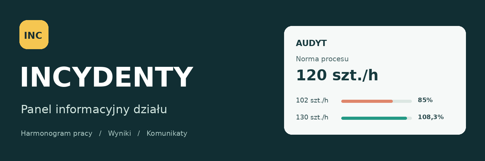
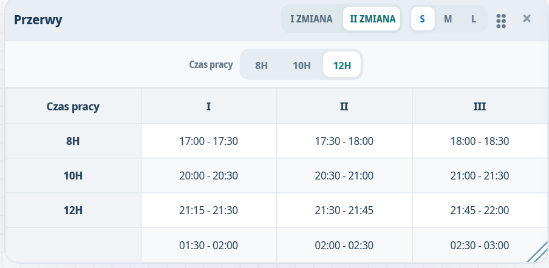
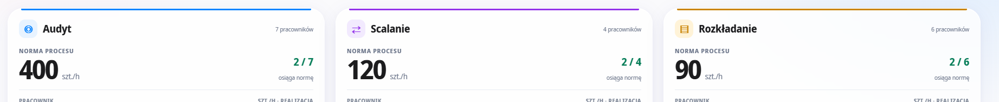

# INCYDENTY

**Panel informacyjny działu · Информационная панель отдела**

[Polski ↓](#polski) · [Русский ↓](#русский) · [Instrukcja PL (PDF)](docs/manuals/INCYDENTY_Instrukcja_1.1.63_PL.pdf) · [Инструкция RU (PDF)](docs/manuals/INCYDENTY_Instrukcja_1.1.63_RU.pdf)

## Polski

Na początku zmiany pracownik może sprawdzić, do którego procesu został przydzielony i o której ma przerwę. W trakcie zmiany ten sam panel pokazuje wyniki procesów, karty pracowników i ogłoszenia ze zdjęciami. Osoba prowadząca zmianę przygotowuje dane na komputerze i wybiera, co trafi na telewizory.

### Pierwszy pokaz

1. Pobierz [przykładowy raport procesów](docs/examples/01_Wyniki_procesow.xlsx).
2. W aplikacji wybierz **Wyniki i normy → Wyniki procesów → Wczytaj Excel**. W oknie **Okres wyników** ustaw daty raportu lub wybierz **Pomiń**.
3. Otwórz **AUDYT**. W pliku wzorcowym norma wynosi **120 szt./h**. Wyniki 102 i 130 szt./h dają odpowiednio 85% i około 108,3%. Licznik **osiąga normę** powinien pokazać **1 / 2**.
4. Wybierz **Tryb TV → Jeden stały ekran**, wskaż wyniki i kliknij **Uruchom pokaz**. Klawisz **Esc** kończy pokaz.

### Cztery widoki panelu

| Widok | Do czego służy |
| --- | --- |
| **Harmonogram pracy** | Łączy grafik z rozkładem przerw. Wybierz zmianę i czas pracy 8H, 10H lub 12H. Ikoną oka możesz ukryć na TV jedną osobę lub cały zespół. |
| **Wyniki procesów** | Pokazuje normę, tempo pracy każdej osoby i procent realizacji. Na odprawie możesz otworzyć jeden proces albo zestawić wszystkie obok siebie. |
| **Karty pracowników** | Zbiera wszystkie procesy jednej osoby za wybrany okres. KPI za okres jest średnią ważoną czasem pracy w poszczególnych procesach. |
| **Tablica informacyjna** | Pozwala przygotować ogłoszenie w jednym z siedmiu układów. Dodaj tekst lub zdjęcia, zapisz podstronę i zaznacz jej tytuł w ustawieniach TV. |

*Widżet Przerwy. W nagłówku wybierasz zmianę, a nad tabelą długość dnia pracy. Panel wyróżnia trwającą przerwę lub najbliższą, gdy do jej początku pozostało najwyżej 30 minut.*

### Wzory Excel

Pracuj na kopii wzoru. Zachowaj nazwy arkuszy oraz nagłówki kolumn. Limit jednego pliku **.xlsx** wynosi **10 MB**.

| Pobierz wzór | Arkusz | Co wpisać |
| --- | --- | --- |
| [Wyniki procesów](docs/examples/01_Wyniki_procesow.xlsx) | `RAPORT` | Każdy proces ma osobną sekcję. W A wpisz nazwę procesu, w C np. `NORMA: 120 szt./h`. Poniżej umieść login, sztuki, godziny i wynik w szt./h. |
| [Karta pracownika](docs/examples/02_Karta_pracownika_Export.xlsx) | `Export` | Jeden login i jeden okres na plik. Kolumny: `PROCESS`, `Pieces`, `Time`, `KPI %`. Pod tabelą zachowaj filtry `Login TH` i `Date`. Wartość 0,95 oznacza 95%. |
| [Grafik na jutro](docs/examples/03_Grafik_STAN.xlsx) | `STAN` lub `Arkusz1` | Podaj datę i zmianę. Dla każdej grupy umieść login i przypisany proces lub status w sąsiednich kolumnach. |
| [Przerwy](docs/examples/04_Przerwy_agencje.xlsx) | `Sheet2` we wzorze | W A umieść sekcje `I ZMIANA` i `II ZMIANA` z wierszami 8H, 10H i 12H. Przedziały godzin wpisz w B, D i F. |

**Korekta po imporcie.** Nowy raport procesów zastępuje poprzedni. Karty pracowników możesz wczytywać partiami do 25 plików. Aby poprawić jedną kartę, ponownie wczytaj plik z tym samym loginem i obiema datami okresu.

### Dwa telewizory na jednej zmianie

Ustaw rozszerzony pulpit i otwórz dwa okna aplikacji w tym samym profilu przeglądarki. Po imporcie odśwież drugie okno, a następnie przenieś po jednym oknie na każdy TV.

- **TV 1 — przydział.** Ustaw **Jeden stały ekran → Harmonogram pracy**, żeby zespół mógł wrócić do grafiku w dowolnej chwili.
- **TV 2 — wyniki i ogłoszenia.** Wybierz **Automatyczny pokaz**, zaznacz ekrany i ustaw kolejność strzałkami. Dostępne czasy to 10, 15, 20, 30 i 60 sekund. Przy ekranie z trzema stronami 30 sekund oznacza około 10 sekund na stronę.

**Dane i praca offline.** Excel jest odczytywany w przeglądarce. Raporty i ustawienia pozostają w profilu stanowiska, a slajdy ze zdjęciami są przechowywane w IndexedDB. Na innym komputerze ponownie wczytaj pliki. Przed pracą offline otwórz panel online i sprawdź status PWA w **Informacje → Aplikacja**.

[Pełna instrukcja po polsku](docs/manuals/INCYDENTY_Instrukcja_1.1.63_PL.pdf)

---

## Русский

В начале смены сотрудник может посмотреть, на какой процесс он назначен и когда у него перерыв. В течение смены панель показывает результаты процессов, карточки сотрудников и объявления с фотографиями. Руководитель смены загружает данные на компьютере и выбирает, что увидит команда на телевизорах.

### Первый показ

1. Скачайте [учебный отчёт по процессам](docs/examples/01_Wyniki_procesow.xlsx).
2. В приложении откройте **Wyniki i normy → Wyniki procesów → Wczytaj Excel**. В окне **Okres wyników** укажите даты отчёта или нажмите **Pomiń**.
3. Откройте **AUDYT**. В образце норма — **120 шт./ч**. Результаты 102 и 130 шт./ч соответствуют 85% и примерно 108,3%. Счётчик **osiąga normę** покажет **1 / 2**.
4. Выберите **Tryb TV → Jeden stały ekran**, укажите экран результатов и нажмите **Uruchom pokaz**. Клавиша **Esc** завершает показ.

### Четыре раздела панели

| Раздел в приложении | Для чего он нужен |
| --- | --- |
| **Harmonogram pracy** | Показывает расстановку и перерывы. Выберите смену и длительность рабочего дня — 8H, 10H или 12H. Значком глаза можно скрыть на ТВ отдельного сотрудника или команду. |
| **Wyniki procesów** | Показывает норму, скорость каждого сотрудника и процент выполнения. Для обсуждения на смене можно открыть один процесс или несколько рядом. |
| **Karty pracowników** | Объединяет все процессы одного сотрудника за период. Итоговый KPI — среднее с учётом времени на каждом процессе. |
| **Tablica informacyjna** | Позволяет собрать объявление в одном из семи макетов. Добавьте текст или фотографии, сохраните слайд и отметьте его название в настройках ТВ. |

*Карточки процессов. Крупное число — норма в штуках за час. Дробь рядом показывает, сколько сотрудников её достигли. Данные на снимке отличаются от учебного примера.*

### Образцы Excel

Заполняйте копию образца, сохраняя названия листов и заголовки колонок. Максимальный размер одного файла **.xlsx — 10 МБ**.

| Скачать образец | Лист | Что заполнить |
| --- | --- | --- |
| [Результаты процессов](docs/examples/01_Wyniki_procesow.xlsx) | `RAPORT` | Для каждого процесса создайте секцию. В A укажите название, в C — например, `NORMA: 120 szt./h`. Ниже заполните логин, количество штук, часы и результат в шт./ч. |
| [Карточка сотрудника](docs/examples/02_Karta_pracownika_Export.xlsx) | `Export` | Один логин и один период на файл. Колонки: `PROCESS`, `Pieces`, `Time`, `KPI %`. Под таблицей сохраните фильтры `Login TH` и `Date`. Значение 0,95 означает 95%. |
| [График на завтра](docs/examples/03_Grafik_STAN.xlsx) | `STAN` или `Arkusz1` | Укажите дату и смену. Для каждой группы поместите логин и назначенный процесс или статус в соседние колонки. |
| [Перерывы](docs/examples/04_Przerwy_agencje.xlsx) | `Sheet2` в образце | В A разместите секции `I ZMIANA` и `II ZMIANA` со строками 8H, 10H и 12H. В B, D и F впишите интервалы времени. |

**Как исправить данные.** Новый отчёт процессов заменяет предыдущий. Карточки сотрудников можно загружать партиями до 25 файлов. Чтобы исправить одну карточку, повторно загрузите файл с тем же логином и теми же датами начала и конца периода.

### Два телевизора на одной смене

Включите расширенный рабочий стол и откройте два окна приложения в одном профиле браузера. После импорта обновите второе окно и перенесите по окну на каждый ТВ.

- **ТВ 1 — расстановка.** Выберите **Jeden stały ekran → Harmonogram pracy**, чтобы сотрудники могли посмотреть график в любой момент. Панель выделяет текущий перерыв или ближайший, если до его начала осталось не больше 30 минут.
- **ТВ 2 — результаты и объявления.** Выберите **Automatyczny pokaz**, отметьте экраны и задайте порядок стрелками. Доступные интервалы — 10, 15, 20, 30 и 60 секунд. Если внутри экрана три страницы, интервал 30 секунд даст около 10 секунд на каждую.

**Хранение данных и офлайн-режим.** Панель читает Excel в браузере. Отчёты и настройки хранятся в профиле рабочего компьютера, слайды с фотографиями — в IndexedDB. На другом компьютере исходные файлы нужно загрузить заново. Перед работой без сети откройте панель онлайн и проверьте готовность PWA в **Informacje → Aplikacja**.

[Полная инструкция на русском](docs/manuals/INCYDENTY_Instrukcja_1.1.63_RU.pdf)

---

**Autor projektu · Автор проекта** — [Raman Horki](https://github.com/horkiroman4408-cyber)  
**Wersja · Версия** — 1.1.66
