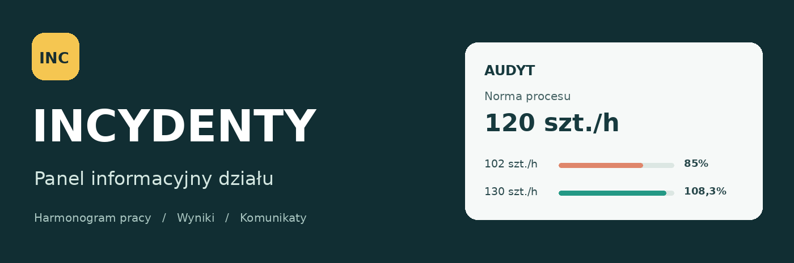
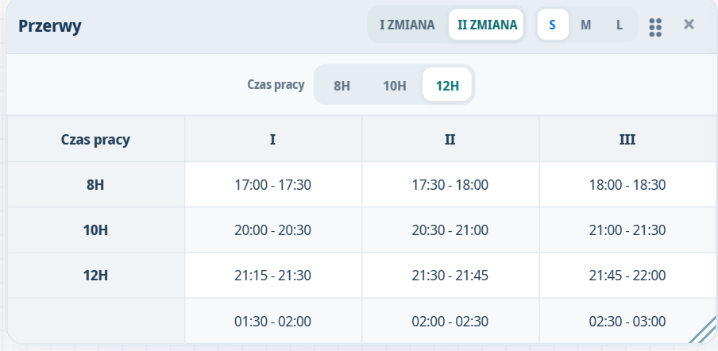
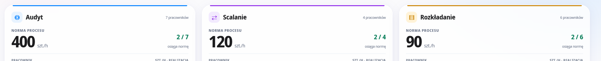

# INCYDENTY · Информационная панель отдела

[Polski](README.md) · **Русский**



На одном телевизоре сотрудники видят, кому назначен процесс и когда перерыв. На втором можно чередовать результаты, карточки сотрудников и объявления. Руководитель смены загружает Excel, выбирает экраны и задаёт время показа.

**[Инструкция на русском (PDF)](docs/manuals/INCYDENTY_Instrukcja_1.1.63_RU.pdf) · [Instrukcja po polsku (PDF)](docs/manuals/INCYDENTY_Instrukcja_1.1.63_PL.pdf) · [Образцы Excel](docs/examples/)**

## Первый показ за четыре шага

1. Скачайте [учебный отчёт по процессам](docs/examples/01_Wyniki_procesow.xlsx).
2. Откройте **Wyniki i normy → Wyniki procesów → Wczytaj Excel** и выберите файл. В окне **Okres wyników** укажите период отчёта или нажмите **Pomiń**, чтобы задать его позже.
3. Откройте **AUDYT**. В образце норма — **120 шт./ч**. Результат 102 шт./ч даёт 85%, а 130 шт./ч — около 108,3%. Счётчик **osiąga normę** покажет **1 / 2**.
4. Выберите **Tryb TV → Jeden stały ekran**, укажите экран результатов и нажмите **Uruchom pokaz**. Клавиша **Esc** завершает показ.

## Что увидит смена

| Раздел приложения | Что можно показать |
| --- | --- |
| **Harmonogram pracy** | Расстановку по процессам, отсутствующих сотрудников и перерывы. Выберите смену и длительность 8H, 10H или 12H. Значок глаза управляет видимостью сотрудника или команды на ТВ. Панель выделяет текущий перерыв или ближайший, если до его начала осталось не больше 30 минут. |
| **Wyniki procesów** | Норму, скорость каждого сотрудника в штуках за час и процент выполнения. Можно вывести один процесс или все сразу. |
| **Karty pracowników** | Все процессы одного сотрудника на одной карточке, время работы и KPI за выбранный период с учётом часов на каждом процессе. |
| **Tablica informacyjna** | Объявления и инструкции с фотографиями. Выберите один из семи макетов, отредактируйте текст прямо на слайде, сохраните его и отметьте в настройках показа. |

### Перерывы и результаты на экране

На виджете **Przerwy** переключатель смены находится в заголовке, а длительность рабочего дня — над таблицей. На примере выбраны вторая смена и 12 часов.



В карточке процесса крупное число показывает норму. Дробь рядом — сколько сотрудников её достигли. На снимке другой отчёт, поэтому числа отличаются от учебного примера.



## Какой Excel загрузить

Скопируйте подходящий образец и замените учебные данные своими. Сохраните имена листов и заголовки колонок. Лимит — **10 МБ на файл `.xlsx`**.

| Образец | Лист | Как заполнить |
| --- | --- | --- |
| [01 · Результаты процессов](docs/examples/01_Wyniki_procesow.xlsx) | `RAPORT` | Для каждого процесса создайте секцию. В колонке A укажите название, в C — например, `NORMA: 120 szt./h`. Ниже разместите логин, количество штук, часы и результат в шт./ч. |
| [02 · Карточка сотрудника](docs/examples/02_Karta_pracownika_Export.xlsx) | `Export` | Один логин и один период на файл. Колонки — `PROCESS`, `Pieces`, `Time`, `KPI %`. Под таблицей сохраните фильтры `Login TH` и `Date`. Для 95% введите в Excel `95%` или число `0,95`. |
| [03 · График на завтра](docs/examples/03_Grafik_STAN.xlsx) | `STAN` или `Arkusz1` | Укажите дату и смену. Для каждой группы оставьте пару соседних колонок — логин слева, процесс или статус справа. |
| [04 · Перерывы](docs/examples/04_Przerwy_agencje.xlsx) | `Sheet2` в образце | В A разместите секции `I ZMIANA` и `II ZMIANA` со строками 8H, 10H, 12H. В B, D и F впишите интервалы, например `08:00 - 08:15`. |

**Как исправить данные.** Новый отчёт процессов заменяет предыдущий. Карточки сотрудников можно загружать партиями до 25 файлов. Чтобы обновить одну карточку, повторно загрузите файл с тем же логином и теми же датами начала и конца. Другой период создаёт отдельную карточку.

## Как читать KPI

- **Выполнение нормы процесса** — скорость в шт./ч, делённая на норму и умноженная на 100%.
- **KPI за период** — среднее с учётом отработанных часов. Восемь часов на процессе влияют на итог в восемь раз сильнее одного часа.
- **Procesy w normie** — число процессов, на которых сотрудник достиг как минимум 100%, из общего числа его процессов.

## Настройка двух телевизоров

Включите расширенный рабочий стол. Откройте два окна панели в одном профиле браузера и перенесите по окну на каждый ТВ. После импорта обновите второе окно перед запуском показа.

| Телевизор | Настройка |
| --- | --- |
| **ТВ 1 · Расстановка** | **Jeden stały ekran → Harmonogram pracy**. Сотрудники в любой момент могут посмотреть свой процесс и перерыв. |
| **ТВ 2 · Результаты и объявления** | **Automatyczny pokaz**. Отметьте нужные экраны, стрелками задайте порядок и установите время для каждого. |

Доступные интервалы — **10, 15, 20, 30 и 60 секунд**. Время отводится на весь экран. При трёх внутренних страницах и интервале 30 секунд каждая будет видна около 10 секунд. Число карточек сотрудников подбирается автоматически или вручную — 5, 10, 15 или 20.

## Где хранятся данные

Панель читает файлы Excel в браузере. Отчёты и настройки хранятся в профиле рабочего компьютера, слайды и фотографии — в IndexedDB. На другом компьютере исходные файлы нужно загрузить заново. Очистка данных сайта может удалить сохранённые отчёты и слайды.

Для работы офлайн сначала откройте приложение с подключением к сети и проверьте готовность PWA в **Informacje → Aplikacja**.

<details>
<summary><strong>Локальный запуск для разработки</strong></summary>

Из корня репозитория запустите сервер статических файлов:

```bash
python -m http.server 8000
```

Откройте `http://localhost:8000/`. В Windows также можно выполнить `py -m http.server 8000`. Учебные файлы для проверки импорта находятся в папке `docs/examples/`.

</details>

---

**Автор проекта · [Roman Horki](https://github.com/horkiroman4408-cyber)**  
Документация для версии **1.1.63**.
