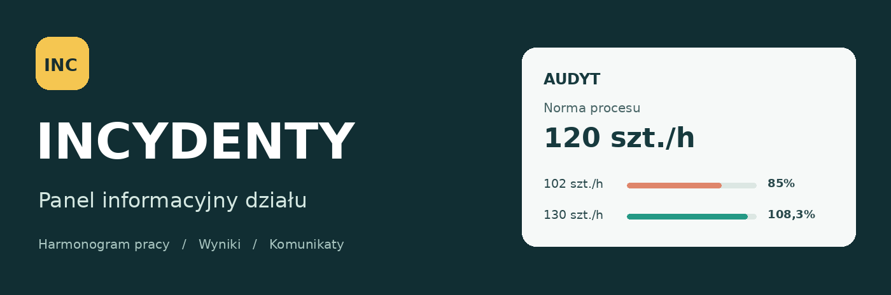
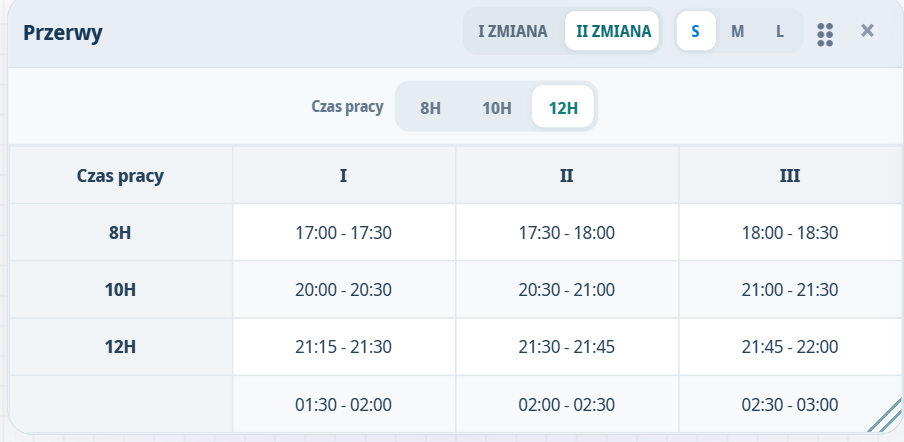
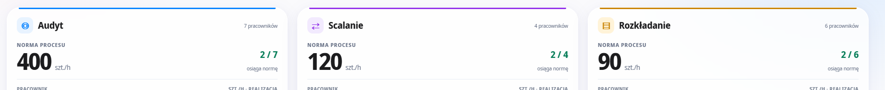
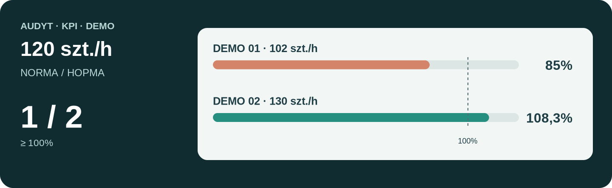
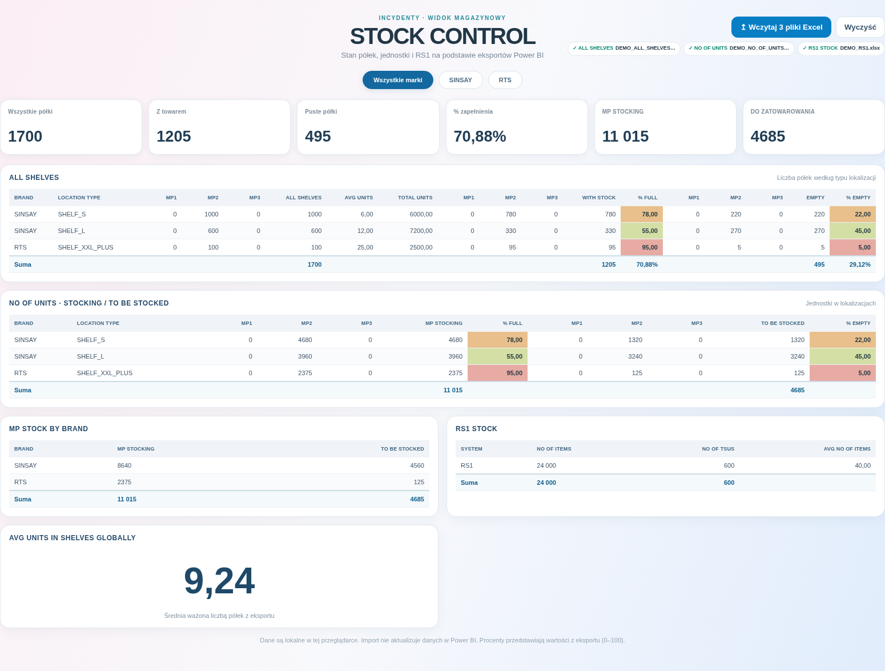
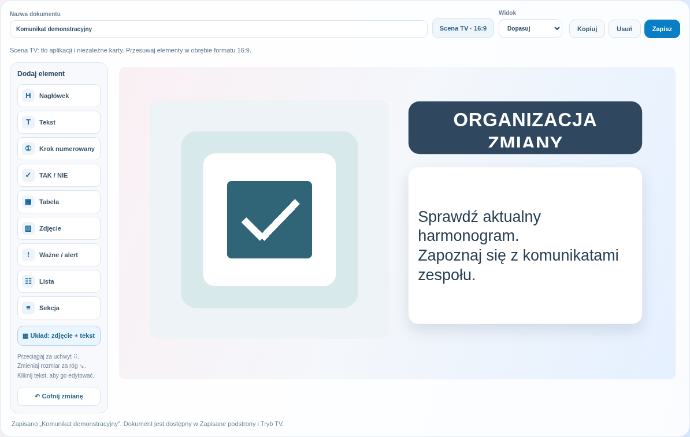
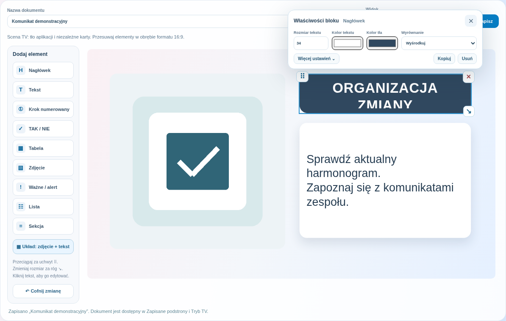
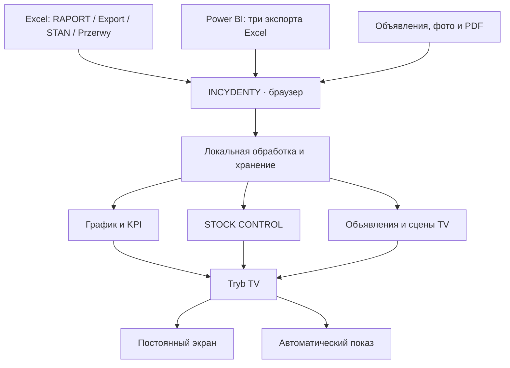

  
  <h1>INCYDENTY</h1>
  
<strong>Информационная панель отдела</strong>

  
Расстановка · KPI · Складской контроль · Коммуникация на ТВ

  
  
  

  
<a href="README.md">Polski</a> · <a href="README_RU.md">Русский</a> · <a href="CHANGELOG.md">Historia / История</a>

  

## О проекте

INCYDENTY — информационная PWA-панель для рабочего места руководителя смены и больших экранов отдела. Она объединяет подготовку данных, объявления и управление показом вместо отдельных таблиц и презентаций. Интерфейс на польском языке; документация доступна также [на польском](README.md).

| Модуль | Что показывает команде |
|---|---|
| **Harmonogram pracy** | Расстановка, отсутствия, перерывы и виджеты |
| **Wyniki i normy** | Результаты процессов и индивидуальные карточки сотрудников |
| **STOCK CONTROL** | Состояние полок, затоваривание и RS1 из экспортов Power BI |
| **Tablica informacyjna** | Объявления, фото, PDF и собственные сцены 16:9 |

[Установка](#запуск-и-установка) · [Модули](#модули) · [Форматы данных](#форматы-данных-и-образцы-excel) · [Режим TV](#режим-tv) · [Документация](#документация-и-версии)

## Запуск и установка

**[Открыть INCYDENTY](https://horkiroman4408-cyber.github.io/Panel-informacyjny/)**. Скачивать установщик не нужно. При первом запуске загрузите собственные данные или учебные файлы из раздела ниже.

| Microsoft Edge | Google Chrome |
|---|---|
| Откройте сайт → `…` → **Aplikacje** → **Zainstaluj tę witrynę jako aplikację** (установить сайт как приложение). | Откройте сайт → значок установки в адресной строке или меню `⋮` → команда установки сайта как приложения. |

Если внутри приложения появилась кнопка **Zainstaluj**, можно воспользоваться и ей. Названия команд зависят от версии браузера. Офлайн-режим доступен после успешного сохранения ресурсов PWA: проверьте **Informacje → Aplikacja**. Обновление лучше устанавливать после завершения показа.

## Модули

### 01 · Harmonogram pracy

Загрузите график `STAN` и отдельный файл перерывов. Выберите смену и длительность рабочего дня 8H, 10H или 12H. Виджеты можно перемещать, а значком глаза настраивать отображение людей и команд на ТВ. Панель выделяет текущий перерыв или ближайший, если до его начала осталось не больше 30 минут.

### 02 · Wyniki i normy

**Wyniki procesów:** Excel-отчёт `RAPORT`, норма процесса, число сотрудников, достигших нормы, результат в шт./ч и процент выполнения. Можно указать период, фильтровать, сортировать и выбрать `Przegląd` или `Jeden proces`. Новый отчёт заменяет предыдущий.

**Karty pracowników:** импорт до 25 файлов одновременно, определение сотрудника по `Login TH` и периоду, KPI с учётом времени, часы и все процессы одного работника. Повторная загрузка того же логина с идентичным периодом обновляет карточку; другой период создаёт отдельную запись. Карточки и отчёт процессов хранятся раздельно.

#### Как читать KPI

- Выполнение нормы = результат в шт./ч ÷ норма × 100%.
- KPI за период = сумма (KPI процесса × время процесса) ÷ сумма времени.
- Процессы в норме = число процессов с KPI не менее 100% относительно всех процессов сотрудника.

*Учебные данные из образца: 85% и 108,3%, то есть один из двух сотрудников достиг нормы.*

### 03 · STOCK CONTROL

Загрузите три экспорта `.xlsx` из Power BI: **ALL SHELVES**, **NO OF UNITS** и **RS1 STOCK**. Приложение определяет тип файла по колонкам листа `Export`, а не по имени. Отображаются все полки, полки с товаром, пустые полки, процент заполнения, MP STOCKING и **DO ZATOWAROWANIA**. Дополнительно доступны таблицы по типам локаций, брендам, RS1 и средневзвешенное количество единиц на полку.

Высокое заполнение выделено красным, низкое — зелёным; цвет `% EMPTY` соответствует дополнительному проценту заполнения. Можно показывать все доступные бренды или фильтровать данные. В TV доступны общий экран, SINSAY и RTS; в RTS таблица RS1 скрыта. Данные обновляются повторным импортом, **не через прямое подключение к Power BI**.

*Снимок из изолированного запуска модуля; значения и имена файлов учебные.*

### 04 · Tablica informacyjna

Три способа подготовить материал в `Zapisane podstrony`:

| Тип | Назначение |
|---|---|
| **Nowa podstrona** | Готовые текстово-графические макеты, редактирование на слайде и всплывающая панель форматирования выделенного текста |
| **Dodaj PDF** | Готовый документ, предпросмотр и отдельный TV-экран; подгонка и кадрирование |
| **Konstruktor** | Свободная композиция независимых блоков на фоне приложения, формат 16:9 |

#### Konstruktor Scena TV

Добавляйте `Nagłówek`, `Tekst`, `Krok numerowany`, `TAK / NIE`, `Tabela`, `Zdjęcie`, `Ważne / alert`, `Lista` или `Sekcja`. Можно выбрать готовую композицию «фото + текст». Перемещайте блоки за ручки, изменяйте размеры, редактируйте текст непосредственно внутри. Всплывающие **Właściwości bloku** позволяют настроить размер и цвет текста, фон, выравнивание, скругление, тень и рамку; дополнительные параметры зависят от типа элемента. В таблице доступны строки и столбцы, у изображения подгонка и положение, у TAK/NIE редактируются вопрос, ответы, подписи и цвета. Блоки можно копировать, удалять и менять порядок слоёв. Сохранённую сцену можно включить в общий TV-показ.

*Снимки редактора из изолированного запуска кода, с нейтральной иллюстрацией и учебным текстом.*

## Как проходит обработка данных

## Форматы данных и образцы Excel

Сохраняйте имена листов и порядок обязательных заголовков. Файлы `.xlsx` до 10 МБ каждый. Складские данные экспортируйте из соответствующих таблиц, а не из скриншота или PDF.

| Файл / образец | Лист | Требования |
|---|---|---|
| [01 · Результаты процессов](docs/examples/01_Wyniki_procesow.xlsx) | `RAPORT` | Секции процессов: название в A, норма в C (например, `NORMA: 120 szt./h`), логин, штуки, часы, результат в шт./ч |
| [02 · Карточка сотрудника](docs/examples/02_Karta_pracownika_Export.xlsx) | `Export` | `PROCESS`, `Pieces`, `Time`, `KPI %`; фильтры `Login TH` и `Date`; один логин и один период |
| [03 · График STAN](docs/examples/03_Grafik_STAN.xlsx) | `STAN` / `Arkusz1` | Дата, смена, логин и соседняя колонка процесса/статуса |
| [04 · Перерывы](docs/examples/04_Przerwy_agencje.xlsx) | `Sheet2` в образце | В A секции `I ZMIANA`, `II ZMIANA` и строки 8H, 10H, 12H; интервалы B, D, F |
| ALL SHELVES | `Export` | `BRAND (LOC SUBAREA)`, `LOCATION TYPE`, группы MP1/MP2/MP3, суммы, `AVG UNITS`, `TOTAL UNITS`, `% OF FULNESS`, `% OF EMPTY` |
| NO OF UNITS | `Export` | `BRAND (LOC SUBAREA)`, `LOCATION TYPE`, группы MP1/MP2/MP3, `MP STOCKING`, `MP TO BE STOCKED` и проценты |
| RS1 STOCK | `Export` | `SYSTEM`, `NO OF ITEMS`, `NO OF TSUS`, `AVG NO OF ITEMS` |

Первые четыре образца доступны в репозитории. Для STOCK CONTROL используйте три оригинальных экспорта Power BI, сохраняя полный состав и порядок колонок. В карточках сотрудников процентное значение `0,95` соответствует 95%; в STOCK CONTROL проценты экспортируются в масштабе 0–100. Ошибка импорта не требует очистки всех данных приложения.

## Режим TV

1. Подготовьте данные и сохраните подстраницы.
2. Нажмите **Tryb TV**. Выберите `Jeden stały ekran` или `Automatyczny pokaz`.
3. Отметьте доступные экраны, настройте порядок и время показа (10, 15, 20, 30 или 60 секунд).
4. Нажмите `Uruchom pokaz`. Доступны настройки, пауза, предыдущий и следующий экран, завершение. Клавиша `Esc` завершает показ. Панель может скрываться через 3 секунды бездействия.

| ТВ 1 | ТВ 2 |
|---|---|
| **Постоянный экран:** Harmonogram pracy, расстановка, перерывы. | **Автопоказ:** результаты, карточки, STOCK CONTROL, объявления, PDF и сцены. |

Используйте расширенный рабочий стол и два окна одного профиля браузера. После изменения данных обновите второе окно до запуска показа. Время экрана может распределяться между его внутренними страницами.

## Данные, офлайн и безопасность

Excel обрабатывается локально. Отчёты и настройки остаются в браузере, а слайды, фотографии, PDF и сцены сохраняются в локальных хранилищах IndexedDB. Приложение не синхронизирует данные между компьютерами автоматически. Очистка данных сайта может удалить сохранённые материалы. Не публикуйте настоящие отчёты, логины сотрудников, внутренние документы и ключи в публичном репозитории. Для отображения PDF может требоваться внешняя библиотека PDF.js; проверьте конкретный документ перед использованием без сети.

## Документация и версии

| Материал | Ссылка |
|---|---|
| Версия приложения | [1.1.65 · 25.11.2026](version.json) |
| История изменений | [CHANGELOG.md](CHANGELOG.md) |
| Инструкция PL | [PDF · v1.1.63](docs/manuals/INCYDENTY_Instrukcja_1.1.63_PL.pdf) |
| Инструкция RU | [PDF · v1.1.63](docs/manuals/INCYDENTY_Instrukcja_1.1.63_RU.pdf) |
| Образцы файлов | [docs/examples](docs/examples/) |

Инструкции PDF относятся к версии 1.1.63 и не охватывают все последующие функции. Актуальное описание модулей находится в этом README. В версии 1.1.65 упорядочена нумерация и обновления PWA; в 1.1.64 добавлены STOCK CONTROL и PDF, улучшен TV-режим.

---

  <strong>INCYDENTY</strong> · Автор проекта: <a href="https://github.com/horkiroman4408-cyber">Raman Horki</a> 
  <a href="https://horkiroman4408-cyber.github.io/Panel-informacyjny/">Открыть приложение</a> · <a href="README.md">Polski</a> · <a href="CHANGELOG.md">История изменений</a>

